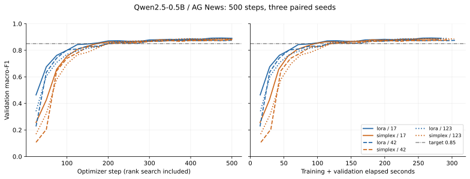

# Full GPU benchmark — 2026-11-01 UTC / 2026-11-02 SGT

**Completed: six independent 500-step runs, 3000 optimizer steps in total.**
The actual CUDA/int8 gate, all six sealed run artifacts, fresh cross-region CPU
restoration and compute deletion passed. This is the formal benchmark, separate
from the earlier eight-step smoke and 50-step gradient diagnosis.

[Successful Actions run and raw artifact](https://github.com/jasonjiang8866/simplexLoRA-bench/actions/runs/41333468131)
· [complete machine-readable analysis](benchmark-41333468131.json)
· [gradient diagnosis](gradient-diagnosis-41331245400.md)
· [deployment and recovery](../../runpod/README.md#current-formal-dispatch).

## Interpretation

Test macro-F1 is very similar in this fixed configuration: LoRA **0.884845 ±
0.005803**, Simplex **0.883818 ± 0.005387**. The paired Simplex-minus-LoRA
mean is **−0.001027 ± 0.001091** F1 units (about −0.103 percentage points).
LoRA is higher on seeds 17 and 42; Simplex is higher by 0.000094 on seed 123.
Three seeds do not establish statistical equivalence, significance or a general
advantage for either method.

All six runs reach validation macro-F1 0.85. Simplex's measured mean time-to-target
is 112.50s versus LoRA's 117.02s, but it is earlier in only two of three pairs;
first-crossing times are quantized by the 25-step evaluation schedule. The mean
step-time difference is under 1% and smaller than the across-seed variability.
There is no robust speed superiority claim from this small comparison.

Simplex uses fewer final adapter parameters (318976–324352 versus 344064), yet
has higher measured peak allocated/reserved memory, including transient rank
updates. Importance weights only deviate from one by about 1e-5, and floor
rounding yields ranks 7–8. The head-dominated joint clipping strongly suppresses
importance SGD updates. These allocations do not demonstrate strong learned
layer-importance differentiation. This is a paper-based stock-PEFT port with
the decisions in [METHOD](../METHOD.md), not a reproduction of the paper's scores.

No initialization, loss reduction, learning rate, spike threshold or clipping
setting was changed after diagnosis. Formal and diagnostic prefixes match
exactly for all six runs: 50 batch hashes, initial heads, learning rates, losses,
gradient norms and rank histories. Within the formal experiment all 500 paired
batch hashes match. The six processes ran sequentially on one GPU, alternating
method order by seed as implemented by the original matrix runner.



## Final fixed-budget accuracy

Mean ± sample standard deviation across three paired seeds. Test data is
evaluated once at the final budget; no best-validation checkpoint selection.

| Method | Validation macro-F1 | Test macro-F1 |
|---|---:|---:|
| lora | 0.8851 ± 0.0086 | 0.8848 ± 0.0058 |
| simplex | 0.8826 ± 0.0040 | 0.8838 ± 0.0054 |

| Seed | LoRA test F1 | Simplex test F1 | Simplex − LoRA |
|---|---:|---:|---:|
| 17 | 0.890668 | 0.888583 | -0.002085 |
| 42 | 0.879062 | 0.877973 | -0.001089 |
| 123 | 0.884805 | 0.884899 | +0.000094 |

Paired difference mean ± sample SD: **-0.001027 ± 0.001091** (F1 units).
Three seeds do not establish a general significance or method superiority claim.

## Time-to-target and censoring

Target: validation macro-F1 ≥ 0.85 at evaluations every 25 steps.
Time begins at training, includes validation, monitoring and rank search,
and excludes model/data setup and final test evaluation. Simplex search-stage
evaluations are ineligible because the adapters are subsequently reinitialized.
The milestone is the first observed eligible crossing, not a sustained threshold.

| Method | Seed | Reached | First eligible step | Time to target (s) | End of observation (s) |
|---|---:|---|---:|---:|---:|
| lora | 17 | True | 175 | 99.907 | 283.945 |
| simplex | 17 | True | 175 | 97.499 | 280.028 |
| lora | 42 | True | 225 | 133.996 | 305.774 |
| simplex | 42 | True | 200 | 118.987 | 296.275 |
| lora | 123 | True | 200 | 117.160 | 293.229 |
| simplex | 123 | True | 200 | 121.009 | 303.210 |

- lora: reached 3/3; right-censored 0; reached-only mean 117.021 s ± 17.044 s (sample SD).
- simplex: reached 3/3; right-censored 0; reached-only mean 112.498 s ± 13.029 s (sample SD).

Unreached times remain null; no zero substitution or mean over censored values.

## Runtime and memory

Step times synchronize CUDA and include probes/optimizer/rank changes, excluding
validation. Steady median excludes startup/search; P95 below is per-run P95.
Peak memory includes the loaded model, training and evaluation; reserved memory
is allocator reservation, not additional tensor memory.

| Method | Step mean (ms) | Steady median (ms) | Per-run P95 (ms) | Peak allocated (GiB) | Peak reserved (GiB) |
|---|---:|---:|---:|---:|---:|
| lora | 178.753 ± 6.054 | 175.059 ± 6.332 | 187.390 ± 8.990 | 4.3877 ± 0.0011 | 4.5540 ± 0.0011 |
| simplex | 177.322 ± 5.441 | 174.034 ± 5.687 | 186.182 ± 7.869 | 4.4700 ± 0.0011 | 4.6530 ± 0.0011 |

| Method | Seed | Training + validation (s) | Setup (s) | Final trainable parameters |
|---|---:|---:|---:|---:|
| lora | 17 | 283.945 | 29.212 | 347648 |
| simplex | 17 | 280.028 | 21.806 | 327936 |
| lora | 42 | 305.774 | 27.174 | 347648 |
| simplex | 42 | 296.275 | 29.549 | 322560 |
| lora | 123 | 293.229 | 25.371 | 347648 |
| simplex | 123 | 303.210 | 27.445 | 324352 |

## Gradient evidence

Original norm >100 threshold and clip max_norm=1.0 remain unchanged.
Expected zero A gradients when B is zero are not treated as missing gradients.

| Method | Seed | Norm >100 steps | Missing / nonfinite | Pre-clip range | Mean head squared-norm share | Maximum post-clip norm |
|---|---:|---:|---:|---:|---:|---:|
| lora | 17 | 41/500 | 0 / 0 | 0.271–274.225 | 99.1350% | 1.000000193 |
| simplex | 17 | 65/500 | 0 / 0 | 0.303–272.789 | 99.2135% | 1.000000188 |
| lora | 42 | 56/500 | 0 / 0 | 0.087–284.443 | 99.5246% | 1.000000191 |
| simplex | 42 | 77/500 | 0 / 0 | 0.162–328.336 | 99.5685% | 1.000000238 |
| lora | 123 | 44/500 | 0 / 0 | 0.262–275.769 | 99.2397% | 1.000000194 |
| simplex | 123 | 64/500 | 0 / 0 | 0.290–281.133 | 99.2513% | 1.000000157 |

Largest analytic head-gradient relative error: 4.482e-05.
Group norms (head, A, B, importance, other), clipping coefficients, losses,
hidden/logit scales, all pairing checks and full rank weights are retained in JSON.

## Rank allocation

| Seed | Step | Total rank / 192 | Layer rank counts | Adapter parameters / 344064 |
|---|---:|---:|---|---:|
| 17 | 10 | 180 / 192 | r7: 12, r8: 12 | 322560 / 344064 |
| 17 | 20 | 182 / 192 | r7: 10, r8: 14 | 326144 / 344064 |
| 17 | 30 | 181 / 192 | r7: 11, r8: 13 | 324352 / 344064 |
| 42 | 10 | 178 / 192 | r7: 14, r8: 10 | 318976 / 344064 |
| 42 | 20 | 178 / 192 | r7: 14, r8: 10 | 318976 / 344064 |
| 42 | 30 | 178 / 192 | r7: 14, r8: 10 | 318976 / 344064 |
| 123 | 10 | 176 / 192 | r7: 16, r8: 8 | 315392 / 344064 |
| 123 | 20 | 179 / 192 | r7: 13, r8: 11 | 320768 / 344064 |
| 123 | 30 | 179 / 192 | r7: 13, r8: 11 | 320768 / 344064 |

LoRA remains r=8 at all 24 q_proj layers. The classifier has 3584 parameters.
Floor rounding leaves unused adapter capacity; rank search and resets are charged
to the same 500-step budget. The JSON preserves all layer-specific ranks and weights.

## Configuration, image and software

- Qwen/Qwen2.5-0.5B, model revision `060db6499f32faf8b98477b0a26969ef7d8b9987`.
- fancyzhx/ag_news, data revision `eb185aade064a813bc0b7f42de02595523103ca4`.
  Both revisions are unchanged from smoke and resolved once for the matrix.
- Train/validation/test 8192/1024/2048; data seed 20261030; paired training seeds
  17/42/123; batch 8, max_length 128, 500 steps per run, evaluation every 25.
- Frozen int8 base, 168 quantized linears; FP32 adapters/head; q_proj r=8,
  alpha=16, AdamW lr=0.0002, weight_decay=0.01, warmup=20, clip max_norm=1.0.
  Simplex rank updates at steps 10/20/30, weight_lr=0.1, regularization=0.01;
  its search and subsequent warmup consume the same total 500-step budget.
- Image: `ghcr.io/jasonjiang8866/simplexlora-bench@sha256:2d630d23e069ed5b486520dbd303c3c35a7cc8c56ec79d269c710819adf7fa08`.
- Image tag: `sha-b5d40812c9ba7eb1a8ef8c28d4b9e0e262367753`.
- Image and controller source SHA: `b5d40812c9ba7eb1a8ef8c28d4b9e0e262367753`.
- Training source hash: `2f1b91c4b02e5d0b937edfd962ef941cb6f1f1497cf3470eba93d4be971734b9`.
- Workflow definition at dispatch: `94702bab9346a73269ff11521fbd5965a6065374`;
  checkout was explicitly pinned to the image source above, not moving main.
- [Image publication 41330245339](https://github.com/jasonjiang8866/simplexLoRA-bench/actions/runs/41330245339)
  and registry digest verification passed; no runtime clone/install was used.
- Python 3.11.14, torch 2.9.0+cu128, transformers 4.57.1, PEFT 0.17.1,
  bitsandbytes 0.48.1, datasets 4.3.0, accelerate 1.11.0; CUDA runtime 12.8.
  The immutable image fixes the installed environment; transitive dependency
  versions are not separately locked in the project specification.
- One NVIDIA RTX PRO 6000 Blackwell Server Edition MIG 1g.24gb, compute
  capability 12.0, visible memory 25367150592 bytes, US-PA-1. The six provenances
  agree on GPU/software. The host driver version was not separately captured.

## Evidence, persistence and cleanup

The workflow's `performance_benchmark` is true and its profile requires exactly
six 500-step runs. The CUDA/int8 gate passed before the matrix; both methods
passed forward/backward, frozen-base and save/reload checks with zero logit
difference. Independent local validation rechecked checkpoint tensor shapes,
all sealed file hashes, contiguous step sequences and regenerated a byte-identical
summary after downloading the artifact. All 3000 steps passed analytic head,
padding/loss, clipping and optimizer checks. Norm >100 flags remain present:
LoRA 141/1500, Simplex 206/1500; missing and nonfinite gradients are zero.

- Actions artifact: `simplex-experiment-41333468131-1`, ID **13095955458**;
  ZIP size **35140586 bytes**, verified SHA-256
  `861bd5d332738a791f1a0ef1575655b584abbf0ef24545d5e8415d80ec2f81f9`.
  GitHub expiry: **2027-01-30T17:49:57Z** (90-day retention).
- Result archive: **107530240 bytes**, 110 files; SHA-256
  `4be2ca2b0669ac9d7fd5e549f94281c53b0d0b0dfdda59b146853102cedb4471`.
- Global Volume `cmvwmviz9000007jteci4ajn8`, retained:
  `/global/simplexlora-bench/simplex-41333468131-1/`.
  It contains `evidence.tar`, `snapshot.json` with per-file SHA-256, and `probe.bin`.
- Completion marker SHA-256:
  `672f81330bcbd741c5b7c5fe5aa3e4a48f2c9a834e69cf8e2447db740bf181b0`.
  The marker was written last without relying on object-storage locks/rename.
- GPU `pu5llyu655a763`, US-PA-1, deleted and confirmed at
  **2026-11-01T18:27:39Z** before the new reader was created.
- CPU `2yoroll205h4on`, AP-JP-1, cpu3c, 2 vCPU, 10GB writable disk,
  restored all 110 files and reproduced the same summary; deleted and confirmed
  at **2026-11-01T18:28:15Z**.
- [Independent final inspection 41336870451](https://github.com/jasonjiang8866/simplexLoRA-bench/actions/runs/41336870451)
  returned **managed_pod_count: 0** at **2026-11-01T18:29:29Z**.
  Old smoke/diagnostic directories and unrelated resources were not deleted.

The historical transport filename in the GitHub ZIP is `smoke-evidence.tar`;
that name does not determine experiment mode. The manifest, acceptance flag,
profile and six 500-step sequences identify this as the formal experiment.

## Cost and measured duration

| Phase | Observed lifetime | Rate | Estimated compute cost |
|---|---:|---:|---:|
| Formal GPU | 2250.570s (37.510 min) | $0.69/h | $0.431359 |
| Formal CPU restore | 36.028s | $0.06/h | $0.000600 |
| Formal total | | | **$0.431960** |
| Prior diagnostic total | | | $0.126540 |
| This session's diagnostic + formal compute | | | **$0.558499** |

The GPU worker itself took 2094.836s; provisioning/retrieval/deletion account
for the remaining observed GPU lifetime. The diagnostic forecast was roughly
36.6 GPU minutes and $0.43 formal compute, close to the measured 37.5 minutes.
The formal controller had a 75-minute GPU deadline, 15-minute CPU deadline,
cleanup reserves and a $1 compute cap, within the user's approved $10 session
budget. These are duration × observed rate estimates, not invoices; existing
volume/storage/request charges are separate. No more expensive GPU fallback
or duplicate GPU creation occurred.

## Reproduce this analysis

Download the formal artifact and the diagnostic artifact from their Actions
runs, verify their ZIP hashes above/in the diagnostic report, and unpack them
into separate directories. The archive can be analyzed without extracting it:

```bash
python runpod/report_experiment.py formal/smoke-evidence.tar \
  --baseline diagnostic/smoke-evidence.tar --output analysis.json
python runpod/render_report.py analysis.json --output tables.md
# Optional plotting dependency; figure generated with matplotlib 3.10.8.
python runpod/plot_experiment.py analysis.json --output curves.svg
```

`analysis.json` reports raw-derived results and prefix checks. The committed
report JSON additionally records Actions artifact metadata, lifecycle evidence,
cleanup inspection and cost calculations from the downloaded controller files.
The original raw archives remain unchanged in Actions and Global Volume.
