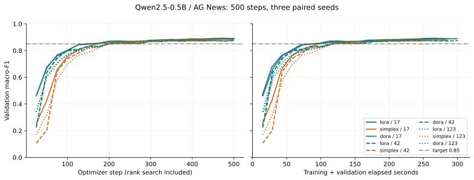
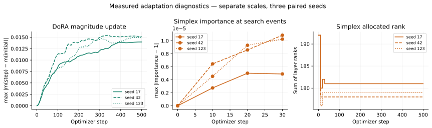

# Three-method formal benchmark — 2026-11-02 SGT

**Complete: nine independent processes × 500 optimizer steps, 4,500 total.** All three methods and all three seeds ran sequentially on one new GPU allocation with the same immutable image. Historical six-run results are preserved separately and are not reused as this batch's baseline.

- [Actions 41399541318](https://github.com/jasonjiang8866/simplexLoRA-bench/actions/runs/41399541318)
- [Raw artifact 13123920180](https://github.com/jasonjiang8866/simplexLoRA-bench/actions/runs/41399541318/artifacts/13123920180): 53,273,092 ZIP bytes, SHA-256 `295c32cfb23b7ba0251afd3af375fddb47de8ecb335175d4baada1010c2d90aa`; 90-day retention.
- Inner archive: 163,522,560 bytes, SHA-256 `9e7453d055eac1b5a2bdbd372494be9423c801ca225b9b45ab8016a4eac679c9`; 170 files, 163,209,130 payload bytes. All hashes/checkpoint shapes and a byte-identical regenerated summary independently verified locally.
- Global Volume: `cmvwmviz9000007jteci4ajn8`; path `/global/simplexlora-bench/simplex-41399541318-1`; snapshot SHA-256 `c0f49f9183b44eb2c2ae7115ae8addd4aa844333904584f349c3861b3563b311`. Historical paths retained.
- Image: `ghcr.io/jasonjiang8866/simplexlora-bench@sha256:3af1106bf5798af9643cce4792f50cea4af832c68a9e803b87dedec9e8a77b71`; image/controller source commit `fba99733fd746af43fe7574e9cbcddb775737162`; training source hash `c9a8254ea13319910afb90a8d7b2a8f85739680936cb3c59150e6547371862a1`.
- Published tag: `ghcr.io/jasonjiang8866/simplexlora-bench:sha-fba99733fd746af43fe7574e9cbcddb775737162`; [image publication 41384626384](https://github.com/jasonjiang8866/simplexLoRA-bench/actions/runs/41384626384). Later report/documentation commits do not change the pinned training image/controller.
- [Configuration](../../configs/benchmark-dora.json); [full manifest and measurements](dora-benchmark-41399541318.json).
- Review: [41399432092](https://github.com/jasonjiang8866/simplexLoRA-bench/actions/runs/41399432092), based on the [nine-run diagnosis](dora-diagnosis-41396288500.md).
- GPU `m10t0w7ays8jlp` in US-PA-1 at $0.69/h; confirmed deleted before fresh CPU `yprpwpohzdqmfo` in EU-CZ-1 at $0.06/h. CPU restoration verified all files and the same summary. Both Pods confirmed deleted.
- [Final independent resource inspection 41406335557](https://github.com/jasonjiang8866/simplexLoRA-bench/actions/runs/41406335557): `managed_pod_count: 0` at 2026-11-02T07:26:45Z.

Execution order: lora/17 → simplex/17 → dora/17 → simplex/42 → dora/42 → lora/42 → dora/123 → lora/123 → simplex/123.

## Validation boundaries

CPU regression, Docker build, real CUDA/int8 gate, nine-run GPU diagnosis, formal training and independent CPU-only recovery are separately evidenced. All 4500 formal steps completed: 0 missing-gradient steps and 0 nonfinite-gradient steps. The frozen base remained unchanged. Optimizer coverage/state and exact saved trainable tensors were verified, including the classifier and DoRA magnitude. Maximum observed reload logit difference: **0.0**.

All paired methods used the same batches and initial classifier for each seed. The diagnostic prefix comparison independently checks data hashes, initial heads and learning rates; CUDA loss/norm differences are recorded rather than assumed zero. No initialization, learning rate, loss reduction, warning threshold or clipping change was made to pass validation. Equal r=8 does not mean equal trainable parameter count.

## Costs and lifecycle

Formal GPU create-to-confirmed-delete duration: **54.026 minutes**; CPU: **5.225 minutes**. Formal compute estimate **$0.626519**; diagnosis plus formal estimate **$0.828779** against the **$4.50** session authorization. Storage/request fees are additional; these are duration×rate estimates, not final invoices. Formal limits were 90 GPU minutes, 15 CPU minutes and $1.20, including cleanup reserves. The archive is below the 512 MiB payload / 1 GiB archive limits.

## Final fixed-budget accuracy

Mean ± sample standard deviation across three paired seeds. Test data is
evaluated once at the final budget; no best-validation checkpoint selection.

| Method | Validation macro-F1 | Test macro-F1 |
|---|---:|---:|
| lora | 0.8850987074 ± 0.0085529542 | 0.8848449786 ± 0.0058031888 |
| simplex | 0.8826301985 ± 0.0039905329 | 0.8838181974 ± 0.0053869999 |
| dora | 0.8850880189 ± 0.0086780288 | 0.8874348790 ± 0.0064631697 |

| Seed | LoRA test F1 | Simplex test F1 | DoRA test F1 |
|---|---:|---:|---:|
| 17 | 0.8906681207 | 0.8885829730 | 0.8916127967 |
| 42 | 0.8790619511 | 0.8779727975 | 0.8799904262 |
| 123 | 0.8848048639 | 0.8848988218 | 0.8907014141 |

Three seeds do not establish a general significance or method superiority claim.

## Time-to-target and censoring

Target: validation macro-F1 ≥ 0.85 at evaluations every 25 steps.
Time begins at training, includes validation, monitoring and rank search,
and excludes model/data setup and final test evaluation. Simplex search-stage
evaluations are ineligible because the adapters are subsequently reinitialized.
The milestone is the first observed eligible crossing, not a sustained threshold.

| Method | Seed | Reached | First eligible step | Time to target (s) | End of observation (s) |
|---|---:|---|---:|---:|---:|
| lora | 17 | True | 175 | 98.259 | 279.367 |
| simplex | 17 | True | 175 | 98.523 | 281.277 |
| dora | 17 | True | 150 | 89.026 | 297.631 |
| lora | 42 | True | 225 | 128.655 | 284.865 |
| simplex | 42 | True | 200 | 114.686 | 286.365 |
| dora | 42 | True | 200 | 119.666 | 300.751 |
| lora | 123 | True | 200 | 114.320 | 286.324 |
| simplex | 123 | True | 200 | 115.822 | 286.200 |
| dora | 123 | True | 200 | 122.237 | 303.256 |

- lora: reached 3/3; right-censored 0; reached-only mean 113.744 s ± 15.206 s (sample SD).
- simplex: reached 3/3; right-censored 0; reached-only mean 109.677 s ± 9.677 s (sample SD).
- dora: reached 3/3; right-censored 0; reached-only mean 110.310 s ± 18.477 s (sample SD).

Unreached times remain null; no zero substitution or mean over censored values.

## Runtime and memory

Step times synchronize CUDA and include probes/optimizer/rank changes, excluding
validation. DoRA magnitude telemetry is included; these are instrumented benchmark
times, not isolated adapter-kernel timings. Steady median excludes startup/search; P95 below is per-run P95.
Peak memory includes the loaded model, training and evaluation, but excludes
the subsequent fresh-model checkpoint-reload verification; reserved memory
is allocator reservation, not additional tensor memory.

| Method | Step mean (ms) | Steady median (ms) | Per-run P95 (ms) | Peak allocated (GiB) | Peak reserved (GiB) |
|---|---:|---:|---:|---:|---:|
| lora | 176.204 ± 0.854 | 171.677 ± 1.413 | 189.533 ± 4.627 | 4.3877 ± 0.0011 | 4.5540 ± 0.0011 |
| simplex | 176.008 ± 3.084 | 171.594 ± 2.417 | 189.459 ± 6.229 | 4.4700 ± 0.0011 | 4.6530 ± 0.0011 |
| dora | 185.920 ± 2.985 | 181.863 ± 2.593 | 203.565 ± 4.763 | 4.5536 ± 0.0010 | 4.7695 ± 0.0000 |

| Method | Seed | Training + validation (s) | Setup (s) | Final trainable parameters |
|---|---:|---:|---:|---:|
| lora | 17 | 279.367 | 25.363 | 347648 |
| simplex | 17 | 281.277 | 21.201 | 327936 |
| dora | 17 | 297.631 | 22.825 | 369152 |
| lora | 42 | 284.865 | 23.304 | 347648 |
| simplex | 42 | 286.365 | 25.361 | 322560 |
| dora | 42 | 300.751 | 23.227 | 369152 |
| lora | 123 | 286.324 | 23.194 | 347648 |
| simplex | 123 | 286.200 | 22.470 | 324352 |
| dora | 123 | 303.256 | 24.250 | 369152 |

## Gradient evidence

Original norm >100 threshold and clip max_norm=1.0 remain unchanged.
Expected zero A gradients when B is zero are not treated as missing gradients.

| Method | Seed | Norm >100 steps | Missing / nonfinite | Pre-clip range | Mean head squared-norm share | Maximum post-clip norm |
|---|---:|---:|---:|---:|---:|---:|
| lora | 17 | 41/500 | 0 / 0 | 0.271–274.225 | 99.1350% | 1.000000193 |
| simplex | 17 | 65/500 | 0 / 0 | 0.303–272.789 | 99.2135% | 1.000000188 |
| dora | 17 | 38/500 | 0 / 0 | 0.334–273.448 | 99.1380% | 1.000000220 |
| lora | 42 | 56/500 | 0 / 0 | 0.087–284.443 | 99.5246% | 1.000000191 |
| simplex | 42 | 77/500 | 0 / 0 | 0.162–328.336 | 99.5685% | 1.000000238 |
| dora | 42 | 55/500 | 0 / 0 | 0.088–285.234 | 99.5254% | 1.000000220 |
| lora | 123 | 44/500 | 0 / 0 | 0.262–275.769 | 99.2397% | 1.000000194 |
| simplex | 123 | 64/500 | 0 / 0 | 0.290–281.133 | 99.2513% | 1.000000157 |
| dora | 123 | 41/500 | 0 / 0 | 0.258–270.622 | 99.1981% | 1.000000181 |

Mean pre-clip group norm across all steps and seeds; — means the group is absent.

| Method | Head | Adapter A | Adapter B | Magnitude | Importance |
|---|---:|---:|---:|---:|---:|
| lora | 52.1607 | 0.689234 | 3.29245 | — | — |
| simplex | 59.273 | 0.676777 | 3.27392 | — | 0.000135726 |
| dora | 51.9945 | 0.684379 | 3.26977 | 0.550146 | — |

| Method | Seed | Clip coefficient min / max | Loss first / last 10 mean | Maximum absolute logit | Mean hidden norm |
|---|---:|---:|---:|---:|---:|
| lora | 17 | 0.00364664 / 1 | 3.344858 / 0.587576 | 18.506805 | 303.605 |
| simplex | 17 | 0.00366584 / 1 | 3.362377 / 0.610916 | 18.259834 | 303.044 |
| dora | 17 | 0.003657 / 1 | 3.356246 / 0.584505 | 18.517139 | 303.698 |
| lora | 42 | 0.00351565 / 1 | 8.364431 / 0.583335 | 15.602596 | 300.255 |
| simplex | 42 | 0.00304566 / 1 | 8.535201 / 0.564885 | 15.602596 | 301.282 |
| dora | 42 | 0.0035059 / 1 | 8.286735 / 0.592667 | 15.602596 | 300.387 |
| lora | 123 | 0.00362622 / 1 | 5.722373 / 0.579723 | 15.792219 | 301.783 |
| simplex | 123 | 0.00355703 / 1 | 5.785565 / 0.555597 | 16.720814 | 300.617 |
| dora | 123 | 0.0036952 / 1 | 5.699808 / 0.572237 | 16.253754 | 301.780 |

Largest analytic head-gradient relative error: 4.482e-05.
Group norms (head, A, B, magnitude, importance, other), clipping coefficients, losses,
hidden/logit scales, all pairing checks and full rank weights are retained in JSON.

## Rank allocation

| Seed | Step | Total rank / 192 | Layer rank counts | Adapter parameters / 344064 |
|---|---:|---:|---|---:|
| 17 | 10 | 180 / 192 | r7: 12, r8: 12 | 322560 / 344064 |
| 17 | 20 | 182 / 192 | r7: 10, r8: 14 | 326144 / 344064 |
| 17 | 30 | 181 / 192 | r7: 11, r8: 13 | 324352 / 344064 |
| 42 | 10 | 178 / 192 | r7: 14, r8: 10 | 318976 / 344064 |
| 42 | 20 | 178 / 192 | r7: 14, r8: 10 | 318976 / 344064 |
| 42 | 30 | 178 / 192 | r7: 14, r8: 10 | 318976 / 344064 |
| 123 | 10 | 176 / 192 | r7: 16, r8: 8 | 315392 / 344064 |
| 123 | 20 | 179 / 192 | r7: 13, r8: 11 | 320768 / 344064 |
| 123 | 30 | 179 / 192 | r7: 13, r8: 11 | 320768 / 344064 |

LoRA remains r=8 at all 24 q_proj layers. The classifier has 3584 parameters.
Floor rounding leaves unused adapter capacity; rank search and resets are charged
to the same 500-step budget. The JSON preserves all layer-specific ranks and weights.

## DoRA paired comparisons

| Seed | DoRA − LoRA | Simplex − LoRA | DoRA − Simplex |
|---|---:|---:|---:|
| 17 | +0.0009446760 | -0.0020851477 | +0.0030298238 |
| 42 | +0.0009284751 | -0.0010891535 | +0.0020176287 |
| 123 | +0.0058965501 | +0.0000939579 | +0.0058025923 |

| Paired difference | Mean ± sample SD |
|---|---:|
| DoRA − LoRA | +0.0025899004 ± 0.0028636541 |
| Simplex − LoRA | -0.0010267811 ± 0.0010908909 |
| DoRA − Simplex | +0.0036166816 ± 0.0019595379 |

## Parameter and optimizer overhead

Same initial rank does not mean equal parameter count. Optimizer bytes are tensor storage, not allocator reservation.

| Method | Seed | Initial model trainable | Final model trainable | Magnitude parameters | Optimizer state bytes | Magnitude Δ L2 / max |
|---|---:|---:|---:|---:|---:|---:|
| lora | 17 | 347648 | 347648 | 0 | 2781380 | 0 / 0 |
| simplex | 17 | 347648 | 327936 | 0 | 2623684 | 0 / 0 |
| dora | 17 | 369152 | 369152 | 21504 | 2953508 | 0.450839 / 0.0139532 |
| lora | 42 | 347648 | 347648 | 0 | 2781380 | 0 / 0 |
| simplex | 42 | 347648 | 322560 | 0 | 2580676 | 0 / 0 |
| dora | 42 | 369152 | 369152 | 21504 | 2953508 | 0.471589 / 0.0151759 |
| lora | 123 | 347648 | 347648 | 0 | 2781380 | 0 / 0 |
| simplex | 123 | 347648 | 324352 | 0 | 2595012 | 0 / 0 |
| dora | 123 | 369152 | 369152 | 21504 | 2953508 | 0.450536 / 0.0148906 |

Simplex also trains 24 external SGD importance scalars during search, hence 347672 initial trainable scalars including importance. These are outside AdamW/model parameter totals and become frozen after search. Its manual SGD update has no momentum state. Magnitude initial/final values, group gradients and per-step changes are retained in raw evidence.

## Historical regression evidence

The earlier six runs used another allocation and software/source batch. They are not pooled with this nine-run experiment; absolute timing comparisons across batches have hardware/load and instrumentation limitations.

| Method | Seed | Historical test F1 | New test F1 | Difference |
|---|---:|---:|---:|---:|
| lora | 17 | 0.8906681207 | 0.8906681207 | +0.0000000000 |
| simplex | 17 | 0.8885829730 | 0.8885829730 | +0.0000000000 |
| lora | 42 | 0.8790619511 | 0.8790619511 | +0.0000000000 |
| simplex | 42 | 0.8779727975 | 0.8779727975 | +0.0000000000 |
| lora | 123 | 0.8848048639 | 0.8848048639 | +0.0000000000 |
| simplex | 123 | 0.8848988218 | 0.8848988218 | +0.0000000000 |

Original head/feature-scale interpretation and the near-unit Simplex importance/floor-rounding limitation remain. Three seeds support descriptive paired comparisons for this configuration, not universal method superiority or statistical equivalence.

## Interpretation of this batch

DoRA exceeds LoRA and Simplex in each of these three paired seeds. Its mean
DoRA−LoRA difference is +0.0025899004 F1 (about 0.259 percentage points), with
sample SD 0.0028636541; this is a small descriptive comparison, not a general
significance claim. The baseline scores reproduced exactly in fresh runs.
All methods reached the validation target in 3/3 seeds; mean time-to-target
is similar relative to the observed seed variation.

DoRA has 21,504 extra trainable magnitude values (+6.19% versus LoRA's total),
172,128 extra AdamW state bytes, about 5.51% higher mean instrumented step time,
and about 0.166 GiB higher peak allocated memory in this batch. These measurements
include magnitude telemetry and should not be interpreted as isolated kernel
benchmarks. No rank adjustment was used to conceal this extra capacity.

The head accounts for most gradient norm; the large-norm flags remain visible
(LoRA 141/1500, Simplex 206/1500, DoRA 134/1500). Simplex importance differs from
one by only about 1e-5 under joint clipping, with floor rounding to ranks 7–8.
This limits what the experiment can say about the proposed rank adaptation.
