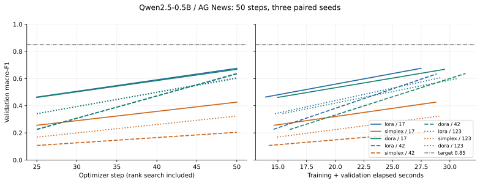
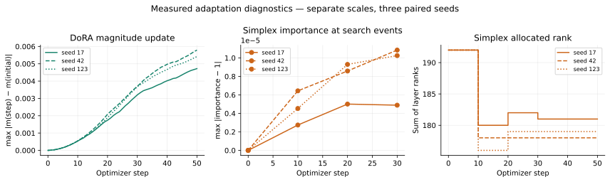

# Three-method CUDA/int8 diagnosis — 2026-11-02 SGT

**Passed: nine independent runs × 50 optimizer steps, 450 total. This is diagnostic evidence, not the 500-step formal benchmark.**

- [Actions 41396288500](https://github.com/jasonjiang8866/simplexLoRA-bench/actions/runs/41396288500)
- [Raw artifact 13119824949](https://github.com/jasonjiang8866/simplexLoRA-bench/actions/runs/41396288500/artifacts/13119824949): 52,039,451 ZIP bytes, SHA-256 `d709cdaa46985ad92c07a401c0b653e58a2063d34a230cb344447a02dbecb355`; 90-day retention.
- Inner archive: 157,081,600 bytes, SHA-256 `ca65392b9f144a85ea8d0a1d4ee225b8575a7eeabccf03cfbc63dd4fdfac5c8e`; 170 files, 156,764,909 payload bytes. Independently revalidated locally with byte-identical summary.
- Global Volume: `cmvwmviz9000007jteci4ajn8`; path `/global/simplexlora-bench/simplex-41396288500-1`; snapshot SHA-256 `b53cd152d038678e216a07eb3729f61022e1b0eb323ee30a3eacd2216efeaacd`.
- Image: `ghcr.io/jasonjiang8866/simplexlora-bench@sha256:3af1106bf5798af9643cce4792f50cea4af832c68a9e803b87dedec9e8a77b71`; source commit `fba99733fd746af43fe7574e9cbcddb775737162`; training source hash `c9a8254ea13319910afb90a8d7b2a8f85739680936cb3c59150e6547371862a1`.
- GPU `7wkwevfzvy0v82` in US-PA-1 at $0.69/h; deleted before fresh CPU `xden7i4o24fl20` in AP-JP-1 at $0.06/h. Cross-region recovery verified all files and same summary; both deletions confirmed.
- Compute estimate **$0.202260**, from create-to-confirmed-delete durations; storage/request fees extra, not an invoiced amount.

## Diagnosis decision

**Proceed without changing hyperparameters.** Real Qwen2 CUDA/int8 forward/backward and checkpoint reload passed for all three methods. The actual Qwen2.5 runs also verify the frozen base, optimizer coverage/state, every trainable saved tensor, classification head, and DoRA magnitude. All nine reloads have maximum logit difference **0**. No missing gradients or NaN/Inf in 450 steps. Expected zero A gradients with initially zero B remain valid.

DoRA has **369,152** trainable model parameters versus **347,648** for LoRA at r=8, including **21,504** additional magnitude values. DoRA magnitude delta L2 spans **0.19868–0.23117**, with max component changes **0.00472–0.00579**. AdamW tensor state is **2,953,508 bytes** versus **2,781,380 bytes** for LoRA.

Head squared-norm share averages **99.773% LoRA / 99.915% Simplex / 99.759% DoRA**; pooled hidden norm is about **296**. Largest analytic head-gradient relative error is **1.887e-7**. The original spike threshold and clipping remain in force. Simplex importance deviations remain at most **1.085e-5**, with rank 7–8 after floor rounding; this limitation remains part of the interpretation.

## Formal forecast and bounds

Observed GPU lifetime plus nine additional copies of the 50-step training/validation cost gives **56.35 GPU minutes**, approximately **$0.6556 including observed CPU restoration**. This is a forecast, not measured formal performance. Use **90-minute GPU / 15-minute CPU deadlines**, **$1.20 phase cap**, and $1.159167 conservative compute ceiling including five-minute cleanup reserves per phase. Session authorization is $4.50; diagnosis used an estimated $0.202260.

Projected formal payload is about **163.9 MB**, below the **512 MiB payload / 1 GiB archive** limits; most diagnostic payload consists of fixed tokenizer files. Actual formal size/count must still pass verification. Execute all nine formal runs in the balanced cyclic manifest order on one GPU; preserve old six-run results as historical evidence.

The following metrics describe the **50-step diagnostic only**.

## Final fixed-budget accuracy

Mean ± sample standard deviation across three paired seeds. Test data is
evaluated once at the final budget; no best-validation checkpoint selection.

| Method | Validation macro-F1 | Test macro-F1 |
|---|---:|---:|
| lora | 0.6387603384 ± 0.0349982915 | 0.6196643759 ± 0.0452288134 |
| simplex | 0.3181366474 ± 0.1111207628 | 0.2985406953 ± 0.1092182260 |
| dora | 0.6355728510 ± 0.0333965501 | 0.6194121765 ± 0.0478854515 |

| Seed | LoRA test F1 | Simplex test F1 | DoRA test F1 |
|---|---:|---:|---:|
| 17 | 0.6706743854 | 0.4113201088 | 0.6734119762 |
| 42 | 0.6038614204 | 0.1932713016 | 0.6027094940 |
| 123 | 0.5844573219 | 0.2910306754 | 0.5821150593 |

Three seeds do not establish a general significance or method superiority claim.

## Time-to-target and censoring

Target: validation macro-F1 ≥ 0.85 at evaluations every 25 steps.
Time begins at training, includes validation, monitoring and rank search,
and excludes model/data setup and final test evaluation. Simplex search-stage
evaluations are ineligible because the adapters are subsequently reinitialized.
The milestone is the first observed eligible crossing, not a sustained threshold.

| Method | Seed | Reached | First eligible step | Time to target (s) | End of observation (s) |
|---|---:|---|---:|---:|---:|
| lora | 17 | False | — | null (right-censored) | 27.481 |
| simplex | 17 | False | — | null (right-censored) | 28.769 |
| dora | 17 | False | — | null (right-censored) | 29.529 |
| lora | 42 | False | — | null (right-censored) | 28.850 |
| simplex | 42 | False | — | null (right-censored) | 27.838 |
| dora | 42 | False | — | null (right-censored) | 31.372 |
| lora | 123 | False | — | null (right-censored) | 29.174 |
| simplex | 123 | False | — | null (right-censored) | 29.071 |
| dora | 123 | False | — | null (right-censored) | 30.725 |

- lora: reached 0/3; right-censored 3; reached-only mean null.
- simplex: reached 0/3; right-censored 3; reached-only mean null.
- dora: reached 0/3; right-censored 3; reached-only mean null.

Unreached times remain null; no zero substitution or mean over censored values.

## Runtime and memory

Step times synchronize CUDA and include probes/optimizer/rank changes, excluding
validation. DoRA magnitude telemetry is included; these are instrumented benchmark
times, not isolated adapter-kernel timings. Steady median excludes startup/search; P95 below is per-run P95.
Peak memory includes the loaded model, training and evaluation, but excludes
the subsequent fresh-model checkpoint-reload verification; reserved memory
is allocator reservation, not additional tensor memory.

| Method | Step mean (ms) | Steady median (ms) | Per-run P95 (ms) | Peak allocated (GiB) | Peak reserved (GiB) |
|---|---:|---:|---:|---:|---:|
| lora | 181.188 ± 6.827 | 170.901 ± 4.072 | 185.181 ± 12.623 | 4.3877 ± 0.0011 | 4.5534 ± 0.0011 |
| simplex | 180.769 ± 2.202 | 170.191 ± 2.362 | 184.293 ± 1.854 | 4.4700 ± 0.0011 | 4.6523 ± 0.0020 |
| dora | 190.388 ± 5.966 | 182.262 ± 3.505 | 195.768 ± 11.009 | 4.5532 ± 0.0006 | 4.7695 ± 0.0000 |

| Method | Seed | Training + validation (s) | Setup (s) | Final trainable parameters |
|---|---:|---:|---:|---:|
| lora | 17 | 27.481 | 25.083 | 347648 |
| simplex | 17 | 28.769 | 24.758 | 327936 |
| dora | 17 | 29.529 | 21.586 | 369152 |
| lora | 42 | 28.850 | 23.846 | 347648 |
| simplex | 42 | 27.838 | 23.357 | 322560 |
| dora | 42 | 31.372 | 23.469 | 369152 |
| lora | 123 | 29.174 | 23.989 | 347648 |
| simplex | 123 | 29.071 | 24.671 | 324352 |
| dora | 123 | 30.725 | 23.935 | 369152 |

## Gradient evidence

Original norm >100 threshold and clip max_norm=1.0 remain unchanged.
Expected zero A gradients when B is zero are not treated as missing gradients.

| Method | Seed | Norm >100 steps | Missing / nonfinite | Pre-clip range | Mean head squared-norm share | Maximum post-clip norm |
|---|---:|---:|---:|---:|---:|---:|
| lora | 17 | 24/50 | 0 / 0 | 38.945–274.225 | 99.8324% | 1.000000125 |
| simplex | 17 | 37/50 | 0 / 0 | 66.032–272.789 | 99.9086% | 1.000000188 |
| dora | 17 | 23/50 | 0 / 0 | 41.598–273.448 | 99.8208% | 1.000000131 |
| lora | 42 | 37/50 | 0 / 0 | 40.004–284.443 | 99.7857% | 1.000000131 |
| simplex | 42 | 49/50 | 0 / 0 | 93.552–328.336 | 99.9584% | 1.000000132 |
| dora | 42 | 37/50 | 0 / 0 | 39.279–285.234 | 99.7755% | 1.000000220 |
| lora | 123 | 25/50 | 0 / 0 | 42.950–275.769 | 99.7018% | 1.000000172 |
| simplex | 123 | 39/50 | 0 / 0 | 76.487–281.133 | 99.8789% | 1.000000133 |
| dora | 123 | 26/50 | 0 / 0 | 45.489–270.622 | 99.6816% | 1.000000126 |

Mean pre-clip group norm across all steps and seeds; — means the group is absent.

| Method | Head | Adapter A | Adapter B | Magnitude | Importance |
|---|---:|---:|---:|---:|---:|
| lora | 124.425 | 0.581994 | 4.39825 | — | — |
| simplex | 167.868 | 0.138542 | 3.99487 | — | 0.00135726 |
| dora | 124.197 | 0.575897 | 4.39464 | 1.38133 | — |

| Method | Seed | Clip coefficient min / max | Loss first / last 10 mean | Maximum absolute logit | Mean hidden norm |
|---|---:|---:|---:|---:|---:|
| lora | 17 | 0.00364664 / 0.0256774 | 3.344858 / 1.292685 | 14.859892 | 297.708 |
| simplex | 17 | 0.00366584 / 0.0151442 | 3.362377 / 2.656366 | 17.216198 | 297.222 |
| dora | 17 | 0.003657 / 0.0240395 | 3.356246 / 1.311496 | 14.977373 | 297.770 |
| lora | 42 | 0.00351565 / 0.0249974 | 8.364431 / 1.277238 | 15.602596 | 294.191 |
| simplex | 42 | 0.00304566 / 0.0106893 | 8.535201 / 4.668594 | 15.602596 | 295.259 |
| dora | 42 | 0.0035059 / 0.0254587 | 8.286735 / 1.321891 | 15.602596 | 294.014 |
| lora | 123 | 0.00362622 / 0.0232831 | 5.722373 / 1.426925 | 15.792219 | 296.786 |
| simplex | 123 | 0.00355703 / 0.0130741 | 5.785565 / 3.466577 | 16.720814 | 296.321 |
| dora | 123 | 0.0036952 / 0.0219833 | 5.699808 / 1.455396 | 16.253754 | 296.843 |

Largest analytic head-gradient relative error: 1.887e-07.
Group norms (head, A, B, magnitude, importance, other), clipping coefficients, losses,
hidden/logit scales, all pairing checks and full rank weights are retained in JSON.

## Rank allocation

| Seed | Step | Total rank / 192 | Layer rank counts | Adapter parameters / 344064 |
|---|---:|---:|---|---:|
| 17 | 10 | 180 / 192 | r7: 12, r8: 12 | 322560 / 344064 |
| 17 | 20 | 182 / 192 | r7: 10, r8: 14 | 326144 / 344064 |
| 17 | 30 | 181 / 192 | r7: 11, r8: 13 | 324352 / 344064 |
| 42 | 10 | 178 / 192 | r7: 14, r8: 10 | 318976 / 344064 |
| 42 | 20 | 178 / 192 | r7: 14, r8: 10 | 318976 / 344064 |
| 42 | 30 | 178 / 192 | r7: 14, r8: 10 | 318976 / 344064 |
| 123 | 10 | 176 / 192 | r7: 16, r8: 8 | 315392 / 344064 |
| 123 | 20 | 179 / 192 | r7: 13, r8: 11 | 320768 / 344064 |
| 123 | 30 | 179 / 192 | r7: 13, r8: 11 | 320768 / 344064 |

LoRA remains r=8 at all 24 q_proj layers. The classifier has 3584 parameters.
Floor rounding leaves unused adapter capacity; rank search and resets are charged
to the same 50-step budget. The JSON preserves all layer-specific ranks and weights.

## DoRA paired comparisons

| Seed | DoRA − LoRA | Simplex − LoRA | DoRA − Simplex |
|---|---:|---:|---:|
| 17 | +0.0027375908 | -0.2593542766 | +0.2620918674 |
| 42 | -0.0011519263 | -0.4105901188 | +0.4094381924 |
| 123 | -0.0023422626 | -0.2934266465 | +0.2910843838 |

| Paired difference | Mean ± sample SD |
|---|---:|
| DoRA − LoRA | -0.0002521994 ± 0.0026567573 |
| Simplex − LoRA | -0.3211236806 ± 0.0793310422 |
| DoRA − Simplex | +0.3208714812 ± 0.0780588768 |

## Parameter and optimizer overhead

Same initial rank does not mean equal parameter count. Optimizer bytes are tensor storage, not allocator reservation.

| Method | Seed | Initial model trainable | Final model trainable | Magnitude parameters | Optimizer state bytes | Magnitude Δ L2 / max |
|---|---:|---:|---:|---:|---:|---:|
| lora | 17 | 347648 | 347648 | 0 | 2781380 | 0 / 0 |
| simplex | 17 | 347648 | 327936 | 0 | 2623684 | 0 / 0 |
| dora | 17 | 369152 | 369152 | 21504 | 2953508 | 0.19868 / 0.00471997 |
| lora | 42 | 347648 | 347648 | 0 | 2781380 | 0 / 0 |
| simplex | 42 | 347648 | 322560 | 0 | 2580676 | 0 / 0 |
| dora | 42 | 369152 | 369152 | 21504 | 2953508 | 0.23117 / 0.00579113 |
| lora | 123 | 347648 | 347648 | 0 | 2781380 | 0 / 0 |
| simplex | 123 | 347648 | 324352 | 0 | 2595012 | 0 / 0 |
| dora | 123 | 369152 | 369152 | 21504 | 2953508 | 0.206308 / 0.00541446 |

Simplex also trains 24 external SGD importance scalars during search, hence 347672 initial trainable scalars including importance. These are outside AdamW/model parameter totals and become frozen after search. Its manual SGD update has no momentum state. Magnitude initial/final values, group gradients and per-step changes are retained in raw evidence.

